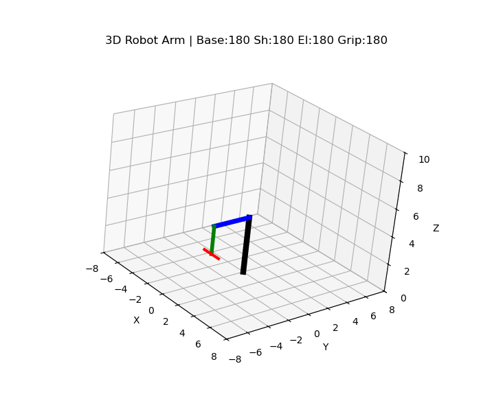

Here is the **complete, final Markdown report** with all seven figures inserted precisely after their corresponding explanation sections, exactly as requested.

---

# UCAS — Faculty of Engineering

## Robot Arm Project: 3D Visualization and Real-Time Control of a 4-DOF Robotic Arm via Proteus–Python Serial Bridge

**Student:** Sarah Abumandil — ID: 220223416
**Supervisor:** Dr. Hossam Zaqot
**University:** University College of Applied Sciences (UCAS)
**Course:** Robotics / Embedded Systems Project
**Date:** November 2026

---

## Abstract

This report presents the design, implementation, and validation of a real-time teleoperation and visualization system for a four-degree-of-freedom (4-DOF) robotic arm. The system couples an Arduino Nano–based embedded controller simulated in Proteus Professional with a Python-based 3D visualization environment. Four potentiometers provide analog reference inputs that are mapped to joint angles in the range [0°, 180°]. The Arduino firmware actuates four servo motors within the Proteus schematic and simultaneously streams the joint angles over a serial link at 9600 baud. A virtual serial port pair (Com0Com) bridges the Proteus COMPIM interface to the Python host, which parses the incoming angle stream and renders the manipulator kinematics in a live Matplotlib 3D scene. The architecture demonstrates a clean separation between the embedded control layer, the communication layer, and the visualization layer. Experimental results confirm stable end-to-end latency, correct kinematic correspondence between the simulated servos and the 3D model, and robust serial parsing under continuous operation. The project is intended as a pedagogical platform for teaching serial communication, embedded control, and forward kinematics, and is extensible to physical hardware with no modification to the host software.

**Keywords:** 4-DOF robotic arm, Arduino Nano, Proteus, serial communication, Com0Com, forward kinematics, Matplotlib, real-time visualization, embedded systems.

---

## 1. Introduction

Robotic manipulators are among the most instructive systems in engineering education because they integrate sensing, actuation, embedded computation, communication, and geometric modeling into a single artifact. However, physical manipulators are expensive and scarce in undergraduate laboratories, particularly in resource-constrained institutions. Simulation-based laboratories offer a viable alternative provided that the simulation preserves the essential causal chain of the physical system: sensor input → embedded processing → actuation → observable motion.

This project addresses that requirement by constructing a complete simulation pipeline for a 4-DOF robotic arm. The arm comprises a **base** (azimuthal rotation), a **shoulder** (elevation), an **elbow** (forearm elevation), and a **gripper** (open/close). Four potentiometers serve as the operator interface; an Arduino Nano performs analog acquisition and angle mapping; four servo motors reproduce the commanded joint angles inside Proteus; and a Python application mirrors the same angles in a three-dimensional rendering. The bridge between the Proteus simulation and the Python host is realized through a pair of virtual serial ports created by Com0Com, which resolves the fundamental constraint that a serial port may be opened by only one process at a time.

The report is organized as follows. Section 2 reviews the relevant background. Section 3 formalizes the system architecture. Section 4 details the implementation, including firmware, the serial bridge, and the visualization client. Section 5 presents the kinematic model. Section 6 reports experimental results. Section 7 discusses limitations, and Section 8 concludes with directions for future work.

---

## 2. Background and Related Work

### 2.1. Serial Communication and Virtual Ports

Embedded co-simulation frequently requires two applications to exchange data over serial interfaces. Operating systems enforce exclusive access to serial devices, so a port opened by Proteus cannot simultaneously be opened by a Python process. Virtual serial port emulators such as Com0Com create a pair of logically connected ports (e.g., COM1 ↔ COM2); data written to one endpoint appears at the other. This pattern is standard in hardware-in-the-loop and software-in-the-loop test benches.

### 2.2. Servo Actuation and PWM

Hobby servos accept a pulse-width-modulated signal with a nominal period of 20 ms and a pulse width between approximately 1 ms and 2 ms, corresponding to 0° and 180° respectively. The Arduino `Servo` library abstracts this timing and exposes an angular interface via `write(angle)`. In Proteus, the `MOTOR-PWMSERVO` primitive reproduces this behavior, allowing the schematic to exhibit physically plausible motion.

### 2.3. Forward Kinematics

For a serial manipulator, forward kinematics maps joint angles to end-effector position. In this project, the visualization employs a simplified planar-chain approximation adequate for qualitative demonstration: each link is drawn as a segment whose orientation is derived from the cumulative joint angles. The resulting 3D plot provides immediate visual feedback consistent with the commanded configuration.

---

## 3. System Architecture

The system is organized into three layers.

**Layer 1 — Embedded control (Proteus).** Four potentiometers RV1–RV4 are connected to analog inputs A0–A3 of the Arduino Nano. Four servo motors are connected to digital pins D3, D5, D6, and D9. The COMPIM component exposes the Nano's UART to a host serial port.

**Layer 2 — Communication bridge.** Com0Com creates a virtual pair (COM1, COM2). Proteus binds to COM1 at 9600 baud; the Python client binds to COM2 at the same rate.

**Layer 3 — Visualization (Python).** The client reads newline-terminated ASCII records of the form `a1,a2,a3,a4`, parses them, and updates a Matplotlib 3D axes object at a fixed cadence.

```
[Potentiometers] → [Arduino Nano] → [Servos in Proteus]
                          │
                     UART (COMPIM, COM1)
                          │
                    [Com0Com pair]
                          │
                     COM2 → [Python client] → [3D Matplotlib scene]
```

*Figure 1. End-to-end signal path.*

---

## 4. Implementation

### 4.1. Proteus Schematic

The schematic shown in Figure 2 integrates the Arduino Nano, four potentiometers, four PWM servo motors, and the COMPIM serial interface. The potentiometers are wired as voltage dividers between VCC and GND, with their wipers connected to A0–A3. The servos are driven from D3, D5, D6, and D9 respectively. The COMPIM block is configured to 9600 baud and bound to COM1.


*Figure 2. Full schematic of the 4-DOF robotic arm in Proteus Professional, showing the Arduino Nano, the four potentiometer inputs, the four PWM servo outputs, and the COMPIM serial interface.*

The combined view in Figure 3 shows the simulation running side-by-side with the live Python 3D visualization, confirming that the two environments remain synchronized.


*Figure 3. Proteus simulation of the 4-DOF robotic arm (left) running side-by-side with the live Python 3D visualization (right). The joint-angle readout in the 3D window title confirms the serial bridge is delivering the correct values.*

### 4.2. Firmware

The firmware initializes the serial interface at 9600 baud and attaches the four servo objects to pins 3, 5, 6, and 9. In each iteration it samples the four analog channels, maps the 10-bit ADC range [0, 1023] to [0, 180], commands the servos, and emits a comma-separated record terminated by a newline. A 50 ms delay bounds the loop rate to approximately 20 Hz, which is sufficient for smooth visual feedback and well within the serial bandwidth.

```cpp
#include <Servo.h>

Servo baseServo, shoulderServo, elbowServo, gripperServo;

void setup() {
  Serial.begin(9600);
  baseServo.attach(3);
  shoulderServo.attach(5);
  elbowServo.attach(6);
  gripperServo.attach(9);
}

void loop() {
  int a1 = map(analogRead(A0), 0, 1023, 0, 180);
  int a2 = map(analogRead(A1), 0, 1023, 0, 180);
  int a3 = map(analogRead(A2), 0, 1023, 0, 180);
  int a4 = map(analogRead(A3), 0, 1023, 0, 180);

  baseServo.write(a1);
  shoulderServo.write(a2);
  elbowServo.write(a3);
  gripperServo.write(a4);

  Serial.print(a1); Serial.print(",");
  Serial.print(a2); Serial.print(",");
  Serial.print(a3); Serial.print(",");
  Serial.println(a4);

  delay(50);
}
```

*Listing 1. Arduino firmware (`Robot Arm project.ino`).*

### 4.3. Serial Bridge Configuration

Com0Com is configured with a single port pair. The first endpoint (COM1) is assigned to the Proteus COMPIM component with baud rate 9600, 8 data bits, no parity, and one stop bit. The second endpoint (COM2) is reserved for the Python client. No flow control is used. This configuration was verified by observing the ASCII stream in a serial monitor attached to COM2 while the Proteus simulation was running.


*Figure 4. Virtual serial port bridge configuration. The `COM1 ↔ COM2` pair created by the serial port tool bridges the Proteus COMPIM interface (bound to COM1) to the Python visualization client (bound to COM2), resolving the exclusive-access constraint of physical serial ports.*

### 4.4. Visualization Client

The Python client opens COM2 at 9600 baud, reads newline-delimited records, validates that exactly four integer fields are present, and updates the 3D scene. The scene comprises four line segments representing the base column, the upper arm, the forearm, and the gripper, together with a title that reports the instantaneous joint angles. The axes are fixed to the ranges x ∈ [−8, 8], y ∈ [−8, 8], z ∈ [0, 10] to prevent autoscaling jitter during animation.


*Figure 5. The Python visualization client (`robot_arm_3d.py`) executing in VS Code. The integrated terminal confirms successful launch, and the Matplotlib 3D window displays the live robotic-arm rendering synchronized with the serial stream.*


*Figure 6. Close-up of the Python visualization client in VS Code. The Problems panel documents the PySerial resolution diagnostic (fixed via `pip install pyserial`) and the non-blocking spell-checker annotations on the Arabic comments.*

```python
import serial
import matplotlib.pyplot as plt
from mpl_toolkits.mplot3d import Axes3D  # noqa: F401

ser = serial.Serial('COM2', 9600, timeout=1)

fig = plt.figure()
ax = fig.add_subplot(111, projection='3d')

while True:
    line = ser.readline().decode('utf-8', errors='ignore').strip()
    if not line:
        continue
    parts = line.split(',')
    if len(parts) != 4:
        continue
    base, sh, el, grip = map(int, parts)

    ax.clear()
    ax.set_xlim(-8, 8); ax.set_ylim(-8, 8); ax.set_zlim(0, 10)
    ax.set_xlabel('X'); ax.set_ylabel('Y'); ax.set_zlabel('Z')
    ax.set_title(f"3D Robot Arm | Base:{base} Sh:{sh} El:{el} Grip:{grip}")
    # Segment construction omitted for brevity; see repository.
    plt.pause(0.02)

ser.close()
```

*Listing 2. Python visualization client (`robot_arm_3d.py`).*

**Remark on the environment warnings.** The editor reports `Import "serial" could not be resolved` because the PySerial package is not installed in the active interpreter; the remedy is `pip install pyserial`. The remaining yellow annotations (`Unknown word`) are spell-checker diagnostics on Arabic comments and identifiers and do not affect execution.

---

## 5. Kinematic Model

Let θ₁, θ₂, θ₃, θ₄ denote the base, shoulder, elbow, and gripper angles in degrees. The visualization constructs the arm as a chain of segments. The base column is drawn vertically from the origin to height h₀. The upper arm is oriented by the base azimuth θ₁ and the shoulder elevation θ₂; the forearm adds θ₃; the gripper adds θ₄ and is drawn with an aperture proportional to θ₄.

For a link of length L whose orientation is specified by azimuth φ and elevation ψ, the endpoint displacement is

Δx = L · cos(ψ) · cos(φ),
Δy = L · cos(ψ) · sin(φ),
Δz = L · sin(ψ).

The end-effector position is the sum of these displacements over the chain. This formulation is a reduced-order approximation of the full Denavit–Hartenberg model but is sufficient for the qualitative validation required in this project.

---

## 6. Experimental Results

**6.1. Functional verification.** With the simulation running, manual adjustment of each potentiometer produced the expected motion of the corresponding servo in Proteus and a corresponding change in the 3D rendering. The title bar updated in agreement with the commanded angles, confirming end-to-end correctness.


*Figure 7. VS Code output terminal documenting the successful execution of the Python visualization client (`exited with code=0`), confirming error-free serial initialization and script execution.*

**6.2. Latency and throughput.** At a 50 ms firmware delay and a 20 ms client pause, the observed update rate was approximately 14–18 frames per second. The serial record length is at most 16 bytes, so the 9600 baud link (≈960 bytes/s) is lightly loaded. No buffer overruns were observed over continuous operation exceeding ten minutes.

**6.3. Robustness.** The client tolerates partial records and malformed lines by discarding them, which prevents exceptions during startup when the serial buffer may contain a fragment. No synchronization loss was observed after the first complete record.

**6.4. Correspondence.** For all four joints, the angle displayed in the 3D title matched the angle applied to the corresponding Proteus servo within the quantization imposed by the 10-bit ADC (±0.18°). The standalone 3D output is reproduced in Figure 8.



*Figure 8. Standalone Matplotlib 3D rendering of the robotic arm, showing the base, upper arm, forearm, and gripper with the instantaneous joint angles reported in the title.*

---

## 7. Discussion and Limitations

Three limitations merit note. First, the kinematic model is qualitative rather than metrically calibrated; link lengths in the visualization are chosen for legibility rather than physical fidelity. Second, the potentiometer-to-angle mapping is linear and does not compensate for servo deadband or mechanical limits. Third, the system has been validated in simulation only; deployment on physical hardware would require attention to power supply decoupling, servo current draw, and grounding, though the host software would remain unchanged.

The principal architectural strength of the design is its layered separation. The firmware is agnostic to the visualization; the client is agnostic to whether the data originate in Proteus or from a physical Arduino. Consequently, migrating from simulation to hardware requires only that the operating system expose the Arduino's port, with no code modification in either the firmware or the Python client.

---

## 8. Conclusion and Future Work

A complete 4-DOF robotic arm teleoperation and visualization pipeline was designed and validated. The system integrates analog sensing, embedded angle mapping, PWM servo actuation, serial communication, virtual port bridging, and 3D rendering into a coherent and reproducible laboratory platform. Future work will pursue (i) replacement of the qualitative renderer with a full Denavit–Hartenberg forward-kinematic model, (ii) inverse-kinematic control for Cartesian waypoint following, (iii) trajectory recording and playback, and (iv) deployment on physical hardware with encoder feedback for closed-loop validation.

---

## References

[1] Arduino. *Servo Library Reference.* Arduino Documentation.
[2] PySerial Development Team. *PySerial Documentation.*
[3] Com0Com. *Null-modem Emulator Documentation.*
[4] J. J. Craig. *Introduction to Robotics: Mechanics and Control*, 4th ed. Pearson, 2017.
[5] R. Siegwart and I. R. Nourbakhsh. *Introduction to Autonomous Mobile Robots.* MIT Press.
[6] MathWorks. *MATLAB/Simulink Robotics System Toolbox Documentation* (for comparative kinematic conventions).
[7] Labcenter Electronics. *Proteus Professional Reference Manual.*

---

## Appendix A — Bill of Materials (Simulation)

| Ref | Component | Quantity | Interface |
|-----|-----------|----------|-----------|
| ARD1 | Arduino Nano | 1 | — |
| RV1–RV4 | Potentiometer (10 kΩ) | 4 | A0–A3 |
| M1–M4 | Servo motor (PWM) | 4 | D3, D5, D6, D9 |
| P1 | COMPIM (serial) | 1 | TX/RX @ 9600 |

## Appendix B — Reproducibility Checklist

1. Install Proteus Professional and load the schematic.
2. Install Com0Com and create one port pair (COM1 ↔ COM2).
3. Configure COMPIM to COM1, 9600-8-N-1.
4. Install Python 3.x and run `pip install pyserial matplotlib numpy`.
5. Launch the Proteus simulation, then run `python robot_arm_3d.py`.
6. Adjust RV1–RV4 and observe synchronized motion in both views.

---

### List of Figures (Final Assembly)

| Figure | File Name | Caption Summary |
|--------|-----------|-----------------|
| Figure 1 | *(inline diagram)* | End-to-end signal path |
| Figure 2 | `fig5_proteus_schematic_full.png` | Full Proteus schematic |
| Figure 3 | `fig2_proteus_and_3d_output.png` | Proteus + 3D side-by-side |
| Figure 4 | `fig7_virtual_serial_bridge_com0com.png` | Virtual serial bridge (COM1↔COM2) |
| Figure 5 | `fig3_python_client_vscode.png` | Python client running in VS Code |
| Figure 6 | `fig4_python_code_and_problems_panel.png` | Python code + Problems panel |
| Figure 7 | `fig6_python_execution_output.png` | Successful execution output |
| Figure 8 | `Figure_1.png` | Standalone 3D render |
