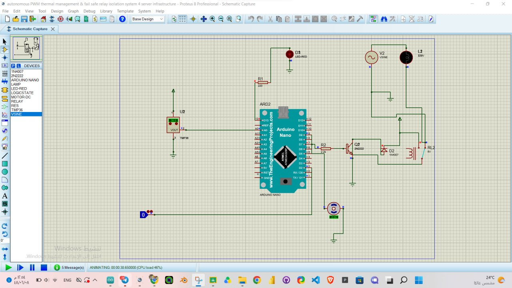

# Autonomous PWM Thermal Management & Fail Safe Relay Isolation System for Server Infrastructure

Bridging physical environmental sensing with digital control systems, this project implements a closed-loop Pulse Width Modulation (PWM) cooling architecture alongside real-time hazard detection for server rooms. Using an ATmega328P (Arduino Nano) microcontroller, the system continuously reads analog thermal data (TMP36) to dynamically adjust cooling fan duty cycles (0–100%) for energy efficiency. Upon detecting critical overheating or optical fire hazards (LogicState/IR), the controller immediately triggers a visual LED alert and drives a transistor-switched 5V Relay (with a flyback protection diode) to isolate high-voltage AC power (220V), ensuring hardware safety and fail-safe resilience.

